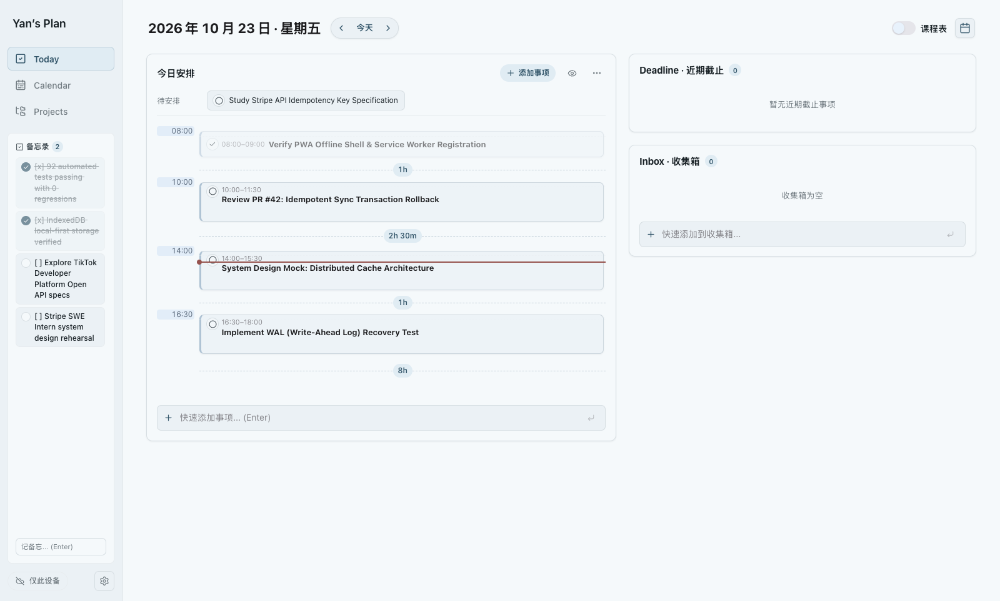
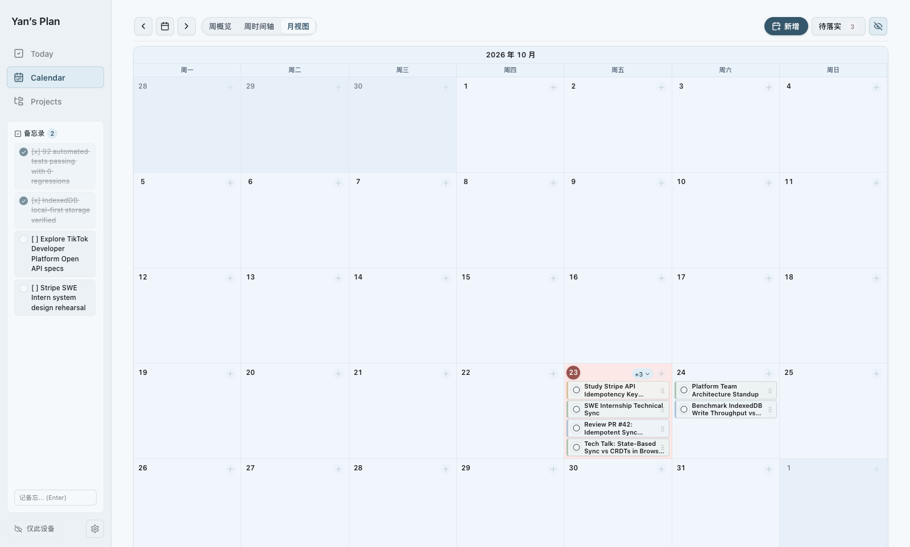
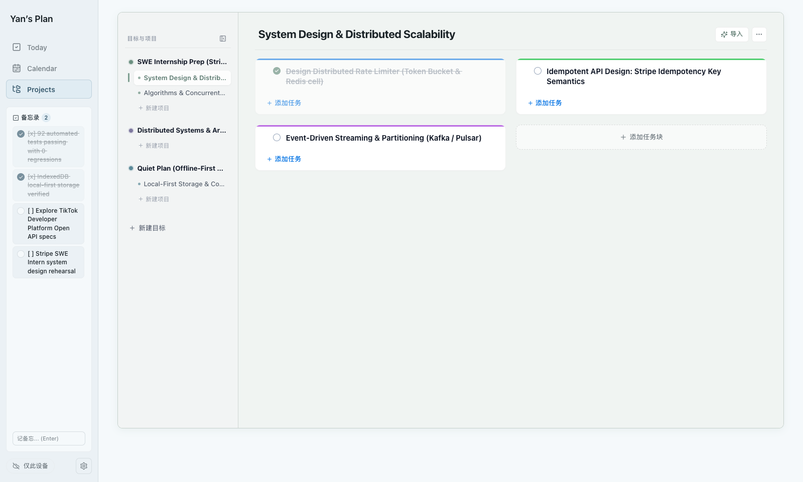
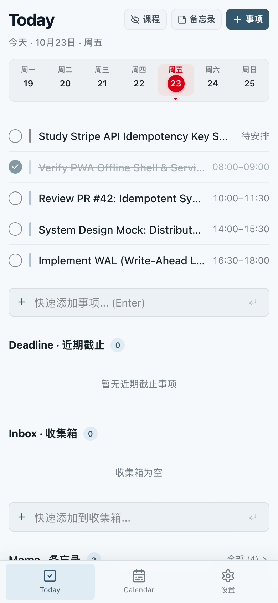
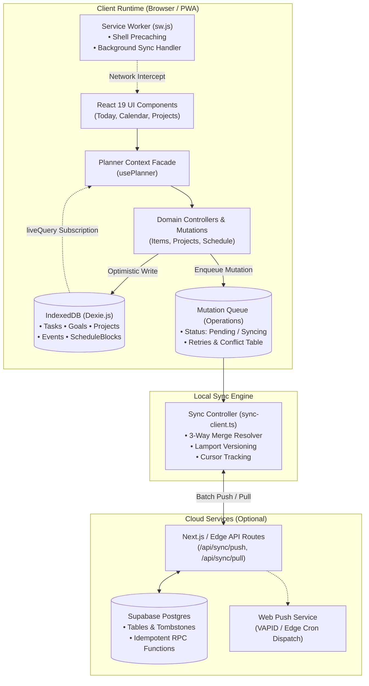

# Quiet Plan — Offline-First Productivity Application

[](https://offline-first-productivity-app.vercel.app)
[](https://github.com/YanCORANV/offline-first-productivity-app)
[](https://github.com/YanCORANV/offline-first-productivity-app)
[](https://github.com/YanCORANV/offline-first-productivity-app)

> **Live Demo:** [https://offline-first-productivity-app.vercel.app](https://offline-first-productivity-app.vercel.app)  
> *No login or signup required. Try creating goals, scheduling tasks, completing checkpoints, and toggling offline mode in DevTools.*

---

## 1. Project Overview

**Quiet Plan** is an offline-first personal productivity and execution application built for high-throughput daily planning. It bridges the gap between high-level ambition and concrete execution by turning raw thoughts into structured goals, hierarchical project trees, and time-blocked calendar schedules. Engineered with a **local-first philosophy**, all state mutations commit instantaneously to browser IndexedDB with zero network latency, while an idempotent operation queue synchronizes with cloud storage when connectivity is available.

---

## 2. Live Demo & Interactive Sandbox

Experience the production build directly in your browser:

🔗 **[Launch Interactive Demo](https://offline-first-productivity-app.vercel.app)**

- **Instant Zero-Auth Access**: Preloaded with realistic software engineering sample data (distributed systems projects, algorithm review, technical syncs).
- **Full Interactivity**: Create and reorder goals, expand and collapse project nodes, mark tasks complete, schedule time blocks, and take quick memos.
- **Offline Resilience**: Open Chrome DevTools → Network → set to **Offline** (or toggle airplane mode). The application continues to render, compute schedules, and persist data across page refreshes via Service Worker and IndexedDB.
- **Data Isolation**: Guest interactions are completely isolated in your browser's local storage and never touch production credentials or external databases.

---

## 3. Product Walkthrough

### Today Dashboard & Daily Execution
Dynamic time-grid matching free time gaps, scheduled tasks, and sticky memos with instantaneous checkbox updates.


### Visual Calendar & Weekly Schedule
Multi-day timeline view supporting time-block scheduling, course slots, and non-overlapping candidate assignment.


### Hierarchical Projects & Goal Breakdown
Multi-level project tree with DAG cycle prevention, checkpoint leaf nodes, and derived milestone progress metrics.


### Mobile-Optimized PWA
Responsive interface with tactile bottom navigation, touch targets, and full offline standalone installation support.
<p align="center">
  
</p>

---

## 4. Key Engineering Features

### 1. Offline-First Architecture & Service Worker Lifecycle
- **Zero-Latency Interactions**: The UI never awaits remote network roundtrips for writes. State changes commit synchronously to memory and asynchronously to IndexedDB in a single user tick.
- **PWA Service Worker (`public/sw.js`)**: Implements stale-while-revalidate shell caching, background sync registration, and push notification receipt. The application remains fully functional without an internet connection.
- **Network Decoupling**: Application health and cloud synchronization status are decoupled; when unconfigured or offline, the app operates in pure local mode without mock error prompts.

### 2. High-Performance IndexedDB Storage (Dexie.js)
- **Typed Entity Stores**: Nine dedicated tables (`thoughts`, `tasks`, `events`, `goals`, `projects`, `projectNodes`, `scheduleBlocks`, `operations`, `conflicts`) with indexed fields for sub-millisecond querying.
- **Declarative Reactive Queries**: Leverages Dexie `liveQuery` observables across components, ensuring state re-renders only for relevant table subscriptions.
- **Schema Migration Pipeline**: Safe transactional upgrades (v1 through v3) that handle store additions, index migrations, and legacy data normalization without data loss.

### 3. Synchronization & Conflict Handling
- **Idempotent Mutation Queue**: Every modifying action creates a deterministic `SyncOperation` entry with client UUIDs, entity timestamps, and Lamport sequence versions.
- **Three-Way Merge Resolution**: Detects field-level collisions between local uncommitted edits and remote state. Disjoint attribute modifications merge automatically; conflicting attributes retain local authority while preserving server records in a queryable `conflicts` table.
- **Transaction Rollbacks & Failure Resilience**: Batch operations (such as multi-task creation or project re-imports) execute inside atomic database transactions. If any step fails, the entire transaction rolls back to preserve database consistency.
- **Tombstones & Cascading Deletions**: Deletions record a `deletedAt` tombstone to propagate removals accurately across sync boundaries, automatically purging dependent schedule blocks and hierarchy links.

### 4. Backend API Integration & Edge Runtime
- **Clean Service Boundaries**: Cloud persistence is encapsulated in `lib/server/supabase.ts` using REST and RPC abstractions, ensuring frontend components remain agnostic to the remote backend.
- **Web Push Notifications**: Push messaging adheres to RFC 8292 VAPID specifications with automated subscription expiration cleanup and database-backed lease scheduling.
- **Zero-Trust Input Validation**: Server routes and AI payload parsers validate payloads strictly through Zod schemas (`lib/server/schemas.ts`).

### 5. Automated Testing & Reliability
- **92 Automated Tests (100% Pass Rate)**: A comprehensive test suite covering core domain algorithms, state invariants, calendar collision detection, and network edge cases.
- **Fault Injection Testing**: Verified behavior under simulated HTTP 500 upload errors, pull sync network partitions, stale cursor recovery, and worker cache invalidation.
- **DOM Layout & PWA Verification**: Automated checks ensure proper server-side shell rendering, absence of horizontal viewport overflow across 6 standard viewport widths (320px to 1600px), and strict CSS module isolation.

---

## 5. System Architecture



---

## 6. Tech Stack

| Domain | Technologies |
| :--- | :--- |
| **Frontend Framework** | React 19, TypeScript 5.9, Next.js (App Router), Lucide Icons |
| **Local Storage & State** | Dexie.js 4.2 (IndexedDB), Reactive `liveQuery` Subscriptions |
| **Bundling & Tooling** | Vite 8, Nitro, PostCSS, Tailwind CSS |
| **Backend & Cloud (Opt)** | Supabase (PostgreSQL, Stored Procedures, Row Level Security) |
| **PWA & Protocols** | Service Worker, Web App Manifest, Web Push (VAPID / RFC 8292) |
| **Scheduling Engine** | RRule (RFC 5545 iCalendar Recurrence), Custom DAG Topological Parser |
| **Validation & Schema** | Zod 4, Drizzle ORM |
| **Testing** | Node.js Native Test Runner (`--test`), Assert Strict, Playwright / CDP |

---

## 7. Local Setup & Testing

### Prerequisites
- Node.js `22.13.0` or higher
- npm `10.0.0` or higher

### Installation

```bash
# Clone the repository
git clone https://github.com/YanCORANV/offline-first-productivity-app.git
cd offline-first-productivity-app

# Install dependencies
npm install
```

### Running Locally

```bash
# Start development server
npm run dev

# Open http://localhost:3000 in your browser
```

### Running Automated Test Suite

```bash
# Runs full build, domain tests, layout validation, and sync regression suite
npm test
```

### Code Quality Verification

```bash
# TypeScript type checking
npx tsc --noEmit

# ESLint code style audit
npm run lint
```

---

## 8. License

MIT License. Designed and engineered by [YanCORANV](https://github.com/YanCORANV).
